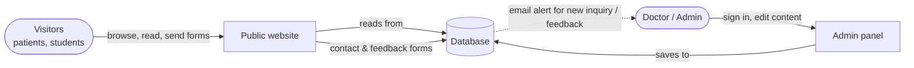
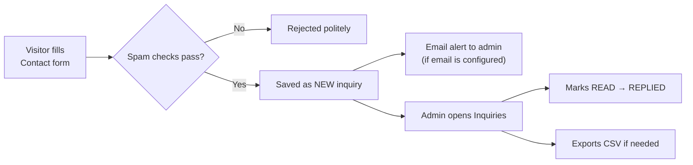
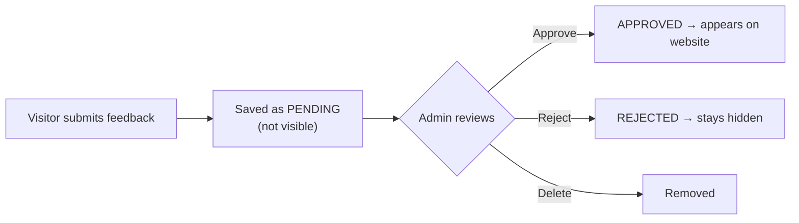
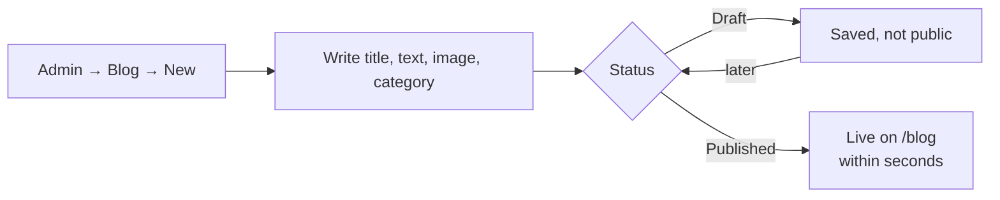

# 1. Project Overview

*Audience: managers, clients and new team members. No technical knowledge needed.*

## What is this project?

A professional website for **Dr. Deepmala Mourya**, an Ayurvedic physician and professor in Bhopal. It has two parts:

1. **The public website** – what patients, students and visitors see.
2. **The admin panel** – a private, password-protected area where the doctor (or an assistant) changes the website content without needing a developer.

## Features

### Public website

| Page | What visitors can do |
|---|---|
| **Home** | See the introduction, services, key numbers, latest articles, testimonials and a call to action |
| **About** | Read the biography, qualifications, career timeline, awards, publications and certificates |
| **Services** | See every treatment/consultation, and open a detail page for each |
| **Blog** | Read health articles; search, filter by category, page through results |
| **Gallery** | Browse photo albums and open photos in a full-screen viewer |
| **Videos** | Watch YouTube / Vimeo / uploaded videos, filter by category |
| **Feedback** | Read approved testimonials and submit their own (shown only after admin approval) |
| **Contact** | Send an inquiry; see phone, email, address, timings and a map |
| **Everywhere** | Medical disclaimer in the footer, WhatsApp/phone buttons, mobile-friendly design |

### Admin panel (`/admin`)

| Section | What the admin can do |
|---|---|
| **Dashboard** | See counts (new inquiries, pending feedback, articles…) and recent activity |
| **Site Settings** | Website name, hero text, contact details, map, social links, SEO text, disclaimer |
| **Profile** | Doctor's name, photo, bio, qualifications, timeline, achievements, publications |
| **Services** | Add / edit / hide / reorder services |
| **Blog** | Write articles with a rich-text editor, save as draft or publish, manage categories |
| **Gallery** | Create albums, upload photos, set captions and cover images |
| **Videos** | Add YouTube/Vimeo links or upload MP4 files |
| **Home Numbers** | The animated statistics on the home page (e.g. "years of experience") |
| **Feedback** | Approve, reject or delete visitor testimonials |
| **Inquiries** | Read contact-form messages, mark as read/replied, export to CSV (Excel) |
| **Change Password** | Update the admin password (signs out all other devices) |

## How the main workflows run

### A visitor sends an inquiry

### A visitor leaves feedback (testimonial)

### The doctor publishes an article

## Roles

| Role | Access | Responsibilities |
|---|---|---|
| **Visitor** | Public pages only | Read content, submit contact & feedback forms |
| **Admin** (doctor / assistant) | Public site + admin panel | Keep content current, moderate feedback, answer inquiries |
| **Developer** | Code, server, database | New features, fixes, deployments, backups — see [Developer guide](3-developer-guide.md) |
| **Tester** | Test environment | Verify features and security before each release — see [Testing guide](4-testing-guide.md) |

There is one admin account. Its password can be reset by a developer with `npm run admin:reset-password`.

## Security & privacy at a glance

- Admin area is password-protected; repeated wrong passwords lock login for 15 minutes.
- Forms are protected against spam bots (hidden trap field, per-visitor limits, optional Google reCAPTCHA).
- Text entered in the editor is cleaned so it can't inject harmful code.
- Uploads are checked for real file type and size (images ≤ 5 MB, videos ≤ 100 MB).
- Visitor IP addresses are stored only as a one-way hash.
- Secrets (passwords, keys) live in a `.env` file that is **never** committed to Git.

## Project status

| Phase | Scope | Status |
|---|---|---|
| 1 | Project setup, design system, database | ✅ Done |
| 2 | Public pages | ✅ Done |
| 3 | Admin login & security | ✅ Done |
| 4 | Admin content management | ✅ Done |
| 5 | Uploads, forms, email | ✅ Done |
| 6 | SEO (titles, sitemap, social previews) | ✅ Done |
| 7 | Testing & documentation | ✅ Done (88 automated checks passing) |

### Before going live (open items)

- [ ] Replace all `[placeholder]` text and images with real content (via admin panel)
- [ ] Choose hosting (recommended: Vercel) and a PostgreSQL database (Neon or Supabase)
- [ ] Create a Cloudinary account for photo/video storage
- [ ] Configure an email account (SMTP) for inquiry alerts
- [ ] Buy/connect the domain name
- [ ] Optional: Google reCAPTCHA keys
- [ ] Browser/mobile visual review and Lighthouse performance check
