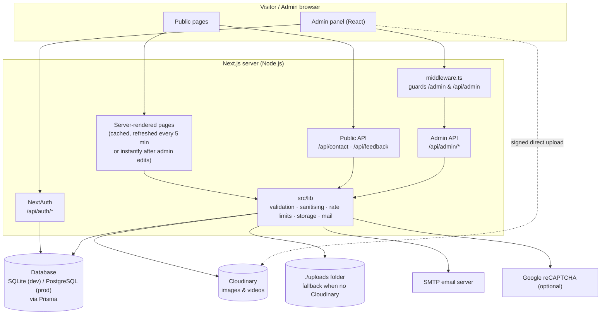
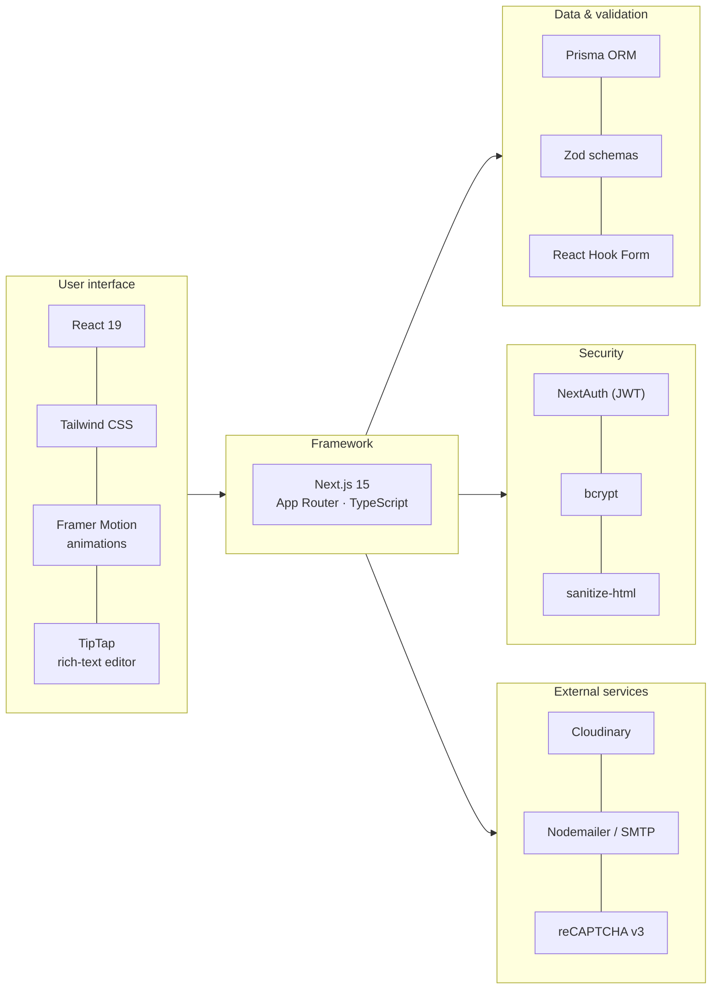
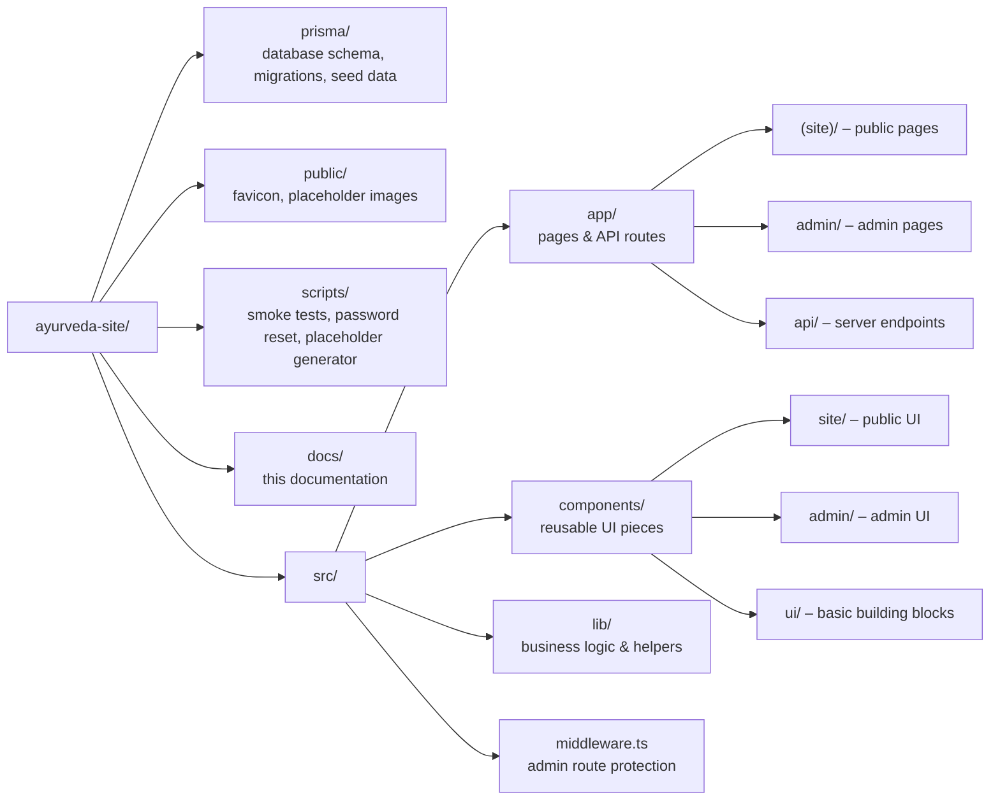
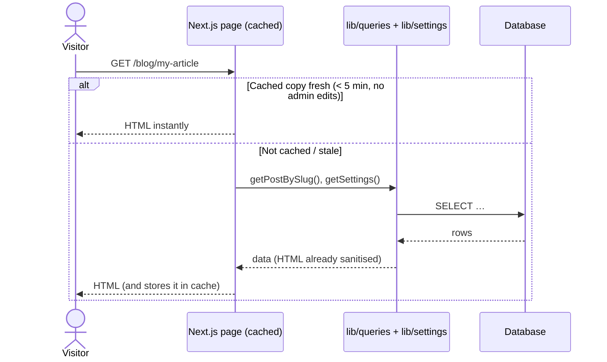
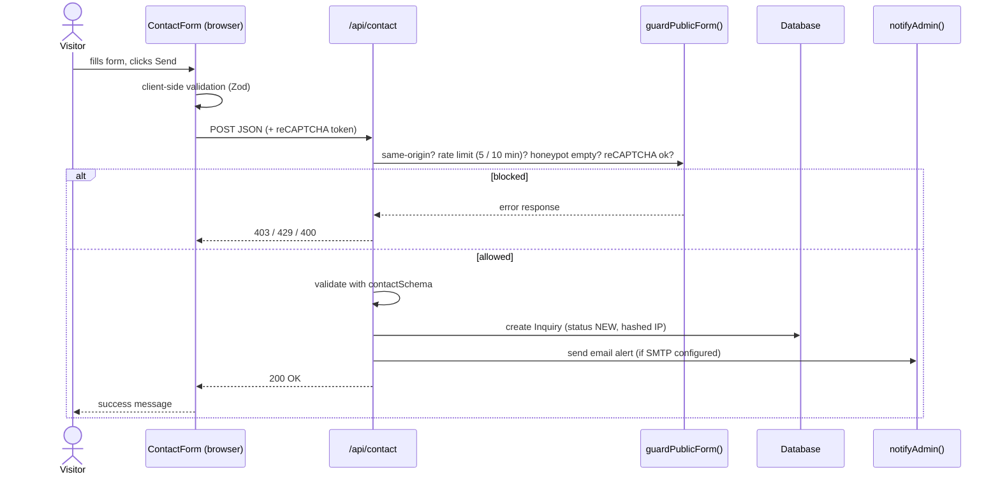
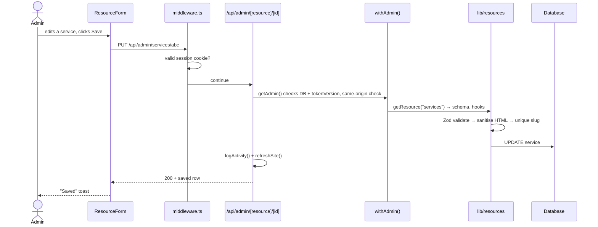
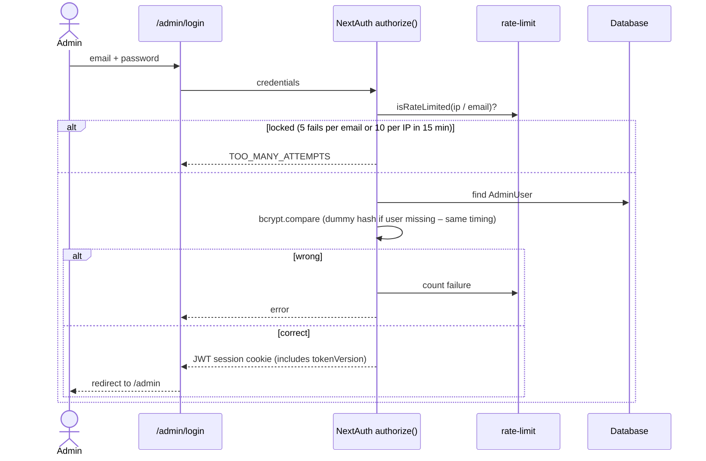
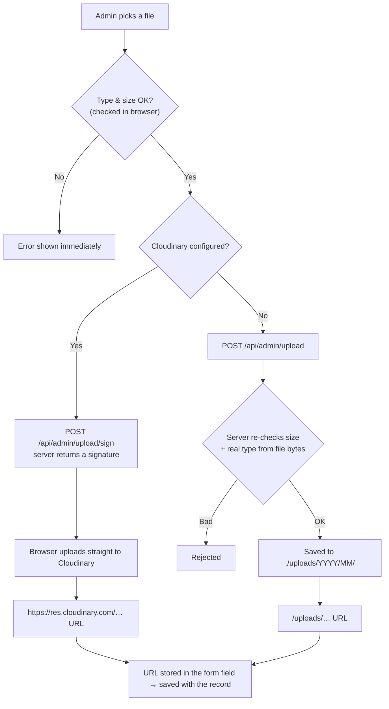
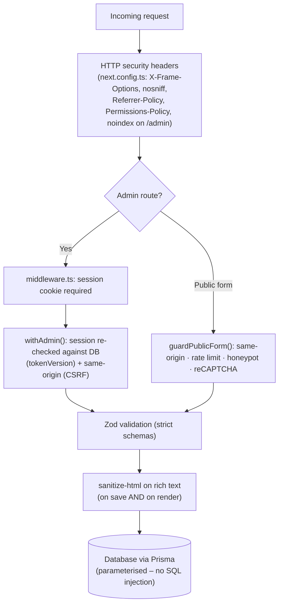

# 2. Architecture & Project Structure

*Audience: everyone for the diagrams; developers for the details.*

## 2.1 The big picture



**Key ideas**

1. **One app, two faces.** The public site and the admin panel are one Next.js application. Route groups `(site)` and `admin/(panel)` give them separate layouts.
2. **Database is the single source of truth.** Every piece of text, image link and setting on the public site comes from the database, so the admin can change it all.
3. **Fast public pages.** Pages are pre-rendered and cached (ISR, `revalidate = 300`). When the admin saves anything, `refreshSite()` clears the cache so changes appear immediately.
4. **Swappable services.** Storage (Cloudinary ↔ local disk), database (SQLite ↔ PostgreSQL) and email are each isolated in one module.

## 2.2 Technology stack



## 2.3 Folder structure



### Full tree with explanations

```text
ayurveda-site/
├── prisma/
│   ├── schema.prisma          # All database tables (models)
│   ├── migrations/            # Versioned database changes
│   └── seed.ts                # Fills an empty database with placeholder content
├── public/
│   ├── favicon.svg
│   └── placeholders/          # Placeholder SVG images (replace via admin)
├── scripts/
│   ├── smoke.mjs              # 88 automated end-to-end checks
│   ├── reset-admin-password.ts
│   └── generate-placeholders.mjs
├── docs/                      # Project documentation (you are here)
├── src/
│   ├── middleware.ts          # Redirects / blocks unauthenticated admin requests
│   ├── app/
│   │   ├── layout.tsx         # Root HTML, fonts, global SEO metadata
│   │   ├── globals.css        # Tailwind + shared styles
│   │   ├── not-found.tsx      # 404 page
│   │   ├── sitemap.ts         # /sitemap.xml
│   │   ├── robots.ts          # /robots.txt
│   │   ├── og/route.tsx       # Generated social-share image
│   │   ├── uploads/[...path]/ # Serves locally stored uploads (supports video seeking)
│   │   ├── (site)/            # PUBLIC PAGES (share navbar + footer layout)
│   │   │   ├── page.tsx                 # Home
│   │   │   ├── about/
│   │   │   ├── services/  + [slug]/     # list + detail
│   │   │   ├── blog/      + [slug]/     # list (search, category, pages) + article
│   │   │   ├── gallery/   + [slug]/     # albums + album photos
│   │   │   ├── videos/
│   │   │   ├── feedback/
│   │   │   └── contact/
│   │   ├── admin/
│   │   │   ├── login/                   # Sign-in page (public)
│   │   │   └── (panel)/                 # PROTECTED ADMIN PAGES (sidebar layout)
│   │   │       ├── page.tsx             # Dashboard
│   │   │       ├── settings/ profile/ services/ blog/ gallery/ gallery/[id]/
│   │   │       └── videos/ stats/ feedback/ inquiries/ password/
│   │   └── api/
│   │       ├── auth/[...nextauth]/      # Login / logout / session
│   │       ├── contact/                 # Public contact form
│   │       ├── feedback/                # Public feedback form (+ optional photo)
│   │       └── admin/
│   │           ├── [resource]/          # GET list · POST create   (generic)
│   │           ├── [resource]/[id]/     # GET · PUT · PATCH · DELETE (generic)
│   │           ├── [resource]/reorder/  # Drag-and-drop ordering
│   │           ├── settings/  profile/  password/
│   │           ├── upload/  upload/sign/  # File upload (local) / Cloudinary signature
│   │           └── export/inquiries/    # CSV download
│   ├── components/
│   │   ├── ui/      # button, input, label, card, badge, dialog, switch, confirm-dialog
│   │   ├── site/    # navbar, footer, hero, cards, forms, gallery grid, sliders, SEO JSON-LD…
│   │   └── admin/   # admin shell, generic resource manager/form, media field, rich-text editor
│   └── lib/         # See developer guide §3.4 for every function
├── .env.example     # Template for environment variables (no real secrets!)
├── next.config.ts   # Security headers, image domains, upload body size
├── tailwind.config.ts  # Colour palette: forest, gold, cream, earth
└── package.json     # Dependencies and npm scripts
```

## 2.4 Data model

```mermaid
erDiagram
    AdminUser {
        string id PK
        string email UK
        string passwordHash
        int tokenVersion "bumped on password change"
    }
    SiteSetting {
        int id PK "always 1"
        string siteName
        string heroTitle
        string phone
        string metaTitle
    }
    Profile {
        int id PK "always 1"
        string fullName
        string photoUrl
        string bioHtml
    }
    Qualification {
        string id PK
        string degree
        int order
    }
    TimelineItem {
        string id PK
        string period
        string title
    }
    Achievement {
        string id PK
        string kind "AWARD | CERTIFICATE | MEMBERSHIP"
        string title
    }
    Publication {
        string id PK
        string title
        string url
    }
    Service {
        string id PK
        string slug UK
        string contentHtml
        bool isVisible
    }
    Category {
        string id PK
        string type "BLOG | VIDEO"
        string slug
    }
    BlogPost {
        string id PK
        string slug UK
        string status "DRAFT | PUBLISHED"
        datetime publishedAt
    }
    GalleryAlbum {
        string id PK
        string slug UK
        string coverImageUrl
    }
    GalleryImage {
        string id PK
        string url
        string caption
    }
    Video {
        string id PK
        string source "YOUTUBE | VIMEO | UPLOAD"
        string url
        bool isFeatured
    }
    Feedback {
        string id PK
        string status "PENDING | APPROVED | REJECTED"
        int rating
        string ipHash
    }
    Inquiry {
        string id PK
        string status "NEW | READ | REPLIED"
        string message
        string ipHash
    }
    Stat {
        string id PK
        string label
        int value
    }
    ActivityLog {
        string id PK
        string action
        string summary
    }

    Category ||--o{ BlogPost : "groups (optional)"
    Category ||--o{ Video : "groups (optional)"
    GalleryAlbum ||--o{ GalleryImage : "contains"
```



**Rules worth knowing**

- `SiteSetting` and `Profile` are *singletons* – exactly one row (id = 1).
- Deleting a category leaves its posts/videos in place (`categoryId` becomes empty). Deleting an album deletes its photos **and** the stored files.
- Lists with an `order` column (services, photos, timeline…) can be drag-sorted in the admin.
- SQLite has no enums, so statuses are strings validated by Zod (`src/lib/validators.ts`).

## 2.5 How requests flow

### Viewing a public page



### Submitting the contact form



### Admin saving content



### Admin login



### File upload



## 2.6 Security layers


