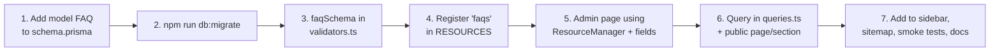
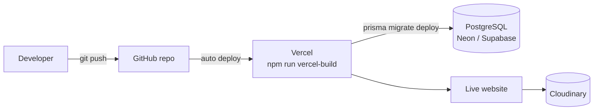

# 3. Developer Guide

*Audience: developers working on the code.*

## 3.1 Setup

**Requirements:** Node.js 20+, npm, Git.

```bash
git clone https://github.com/AmitDehariya/ayurveda-site.git
cd ayurveda-site
npm install
cp .env.example .env          # then edit .env – see the main README for every variable
npm run db:migrate            # creates prisma/dev.db and runs the seed
npm run dev                   # http://localhost:3000  ·  admin at /admin
```

> **Never commit `.env`** or put real passwords/keys in `.env.example` – the repository is public.

## 3.2 npm scripts

| Command | What it does |
|---|---|
| `npm run dev` | Development server with hot reload |
| `npm run build` | `prisma generate` + production build |
| `npm start` | Run the production build |
| `npm run lint` / `npm run typecheck` | ESLint / TypeScript checks (both must be clean before a commit) |
| `npm run db:migrate` | Create & apply a new migration after editing `schema.prisma` (dev) |
| `npm run db:deploy` | Apply migrations in production |
| `npm run db:seed` | Insert placeholder content (safe to re-run – it never overwrites) |
| `npm run db:reset` | ⚠️ Delete all data, re-migrate, re-seed |
| `npm run db:studio` | Browse/edit the database in a web UI |
| `npm run admin:reset-password` | Reset the admin password to `ADMIN_PASSWORD` from `.env` |
| `npm run placeholders` | Regenerate the placeholder SVGs in `public/placeholders/` |
| `npm run test:smoke` | 88 end-to-end checks against a running server (see [Testing guide](4-testing-guide.md)) |

## 3.3 Conventions

- **Server Components by default.** Add `"use client"` only for interactivity (forms, sliders, editor).
- **All input is validated with Zod** (`src/lib/validators.ts`). The same schema validates in the browser (React Hook Form with `zodResolver(schema, undefined, { raw: true })`) and on the server (the authority).
- **Rich text is sanitised twice** – on save (`prepareData`) and on render (`RichContent`).
- **After any admin write call `refreshSite()`** so cached public pages update.
- **Log admin actions** with `logActivity()` – they appear on the dashboard.
- **Status "enums" are strings** (SQLite limitation). Add new values to the constants in `validators.ts`.
- Unused variables must start with `_` (ESLint rule).
- Imports use the `@/` alias for `src/`.

## 3.4 Module reference (`src/lib`)

### Data access

| File | Function / export | Description |
|---|---|---|
| `prisma.ts` | `prisma` | Single shared Prisma client (reused across hot reloads in dev) |
| | `textContains(q)` | Case-insensitive "contains" filter that works on both SQLite and PostgreSQL |
| `settings.ts` | `getSettings()` | Site settings row (id 1), cached per request; falls back to `defaultSettings` if the DB is empty/unreachable |
| | `getProfile()` | Doctor profile row (id 1), same fallback behaviour (`defaultProfile`) |
| | `DEFAULT_DISCLAIMER` | Default medical disclaimer text |
| `queries.ts` | `getVisibleServices()` / `getServiceBySlug(slug)` | Services shown on the site |
| | `getPosts({page, q, category})` | Paginated, searchable published articles (`POSTS_PER_PAGE = 6`) |
| | `getLatestPosts(take)` / `getPostBySlug(slug)` / `getRelatedPosts(id, categoryId)` | Article helpers |
| | `getCategories(type)` | Blog or video categories |
| | `getAlbums()` / `getAlbumBySlug(slug)` | Visible gallery albums with photos |
| | `getVideos(category)` | Visible videos, featured first |
| | `getApprovedFeedback(take?)` | Testimonials with status APPROVED |
| | `getStats()` | Home-page counters |
| | `getAboutData()` | Qualifications, timeline, achievements, publications in one call |
| `inquiries.ts` | `inquiryWhere(params)` | Shared `?status=&q=` filter for the inquiry list and the CSV export |

### Admin API framework

| File | Function / export | Description |
|---|---|---|
| `resources.ts` | `RESOURCES` | **Registry** of every admin-editable table: model, Zod schemas, HTML fields, slug rules, filters, ordering, hooks |
| | `getResource(name)` | Look up a registry entry from the URL (`/api/admin/[resource]`) |
| | `delegate(cfg)` | The Prisma model for a registry entry |
| | `buildWhere(cfg, params)` | Turn allowed query-string filters into a Prisma `where` |
| | `prepareData(cfg, data, existing)` | Sanitise HTML, create a unique slug, run `beforeWrite` hook |
| | `nextOrder(cfg, data)` | Put new items at the end of ordered lists |
| `api.ts` | `withAdmin(handler)` | Wrapper for admin routes: requires a valid admin session + same-origin request, catches errors |
| | `ok(data)` / `fail(msg, status)` | JSON response helpers |
| | `handleError(err)` | Converts Zod/Prisma/unknown errors to friendly JSON (422, 404, 409, 500) |
| | `zodFieldErrors(err)` | `{ field: message }` map for form display |
| | `readJson(req)` | Safe JSON body parsing |
| `admin-guard.ts` | `getAdmin()` | Current admin from the session, verified against the DB **including `tokenVersion`** (so a password change logs out other devices) |
| | `requireAdminPage()` | For admin pages – redirects to `/admin/login` if not signed in |
| `auth.ts` | `authOptions` | NextAuth config: credentials provider, bcrypt check, JWT session, login lockout |
| | `LOGIN_LIMIT` | 5 failed attempts per email (10 per IP) per 15 minutes |
| `revalidate.ts` | `refreshSite()` | Clears the cached public pages after an admin change |
| `activity.ts` | `logActivity(action, entity, summary)` | Writes to the dashboard activity log; never throws |
| `client-api.ts` | `api(method, url, body)` | Browser-side fetch wrapper for the admin panel; throws `ApiError` with per-field messages |

### Security & validation

| File | Function / export | Description |
|---|---|---|
| `validators.ts` | `settingsSchema`, `profileSchema`, `serviceSchema`, `postSchema`, `albumSchema`, `galleryImageSchema`, `videoSchema`, `categorySchema`, `qualificationSchema`, `timelineSchema`, `achievementSchema`, `publicationSchema`, `statSchema`, `feedbackAdminSchema`, `inquiryAdminSchema`, `contactSchema`, `feedbackPublicSchema` | Zod schemas for every form/API |
| | `mediaUrl` / `optionalMediaUrl` | Accept only `/uploads/…` or `http(s)://` links (blocks `javascript:`) |
| | `safeMapEmbed(input)` | Accepts a Google Maps embed URL or `<iframe>` code and returns only a safe Google URL |
| | `*_STATUSES`, `VIDEO_SOURCES`, `ACHIEVEMENT_KINDS`, `CATEGORY_TYPES`, `PREFERRED_TIMES` | Allowed string values |
| `sanitize.ts` | `sanitizeRichText(html)` | Allow-list HTML cleaner for editor content (safe links, images, YouTube iframes) |
| | `stripAllTags(text)` | Remove every tag (plain-text fields) |
| `rate-limit.ts` | `rateLimit(key, limit, windowMs)` | Count a hit and say whether it is allowed (in-memory; swap for Redis on multi-server hosting) |
| | `isRateLimited(...)` / `resetRateLimit(key)` | Check without counting / clear |
| | `getClientIp(headers)` | Client IP from `x-forwarded-for` / `x-real-ip` |
| | `hashIp(ip)` | One-way hash stored instead of the raw IP |
| `public-form.ts` | `guardPublicForm(req, opts)` | Spam checks for public forms: same-origin → rate limit → honeypot (`website` field) → reCAPTCHA |
| `recaptcha.ts` | `verifyRecaptcha(token, action, ip)` | Google reCAPTCHA v3 check; passes automatically when no secret key is set |

### Files, email & utilities

| File | Function / export | Description |
|---|---|---|
| `upload-rules.ts` | `UPLOAD_RULES` | Images: JPG/PNG/WebP ≤ 5 MB · Video: MP4 ≤ 100 MB |
| | `checkUpload(kind, type, size)` / `acceptAttr(kind)` | Shared browser+server check / `<input accept>` value |
| `storage.ts` | `isCloudinaryEnabled()` | True when all Cloudinary env vars are set |
| | `saveUpload(file, kind)` | Server-side save (Cloudinary or `./uploads/YYYY/MM/`) after size + magic-byte check |
| | `signUpload(kind)` | Signature for direct browser → Cloudinary upload |
| | `sniffMime(bytes)` | Detect real file type from the first bytes |
| | `deleteStoredFile(url)` | Remove a stored file (Cloudinary or local); never throws |
| `upload-client.ts` | `uploadFile(file, kind, onProgress)` | Browser helper – chooses Cloudinary-direct or server upload, reports progress |
| `mail.ts` | `notifyAdmin({subject, rows, replyTo})` | Email the admin about a new inquiry/feedback (skipped if SMTP not configured; header-injection safe) |
| `video.ts` | `youtubeId(url)` / `vimeoId(url)` / `detectSource(url)` | Parse video links |
| | `embedUrl(source, url)` / `videoThumbnail(source, url, custom)` | Privacy-friendly embed URL / thumbnail |
| `utils.ts` | `cn(...)` | Merge Tailwind class names |
| | `slugify(text)` | URL-friendly slug |
| | `safeDecode(value)` | `decodeURIComponent` that never throws |
| | `formatDate`, `stripHtml`, `truncate`, `readingTime`, `splitTags`, `digitsOnly` | Text helpers |
| | `absoluteUrl(path)` / `shareImage(...urls)` | Full URLs for SEO / pick the first usable share image |

## 3.5 API reference

### Public

| Method & path | Purpose | Protection |
|---|---|---|
| `POST /api/contact` | Save inquiry + email admin | `guardPublicForm` – 5 per IP per 10 min |
| `POST /api/feedback` | Save feedback (multipart, optional photo) as PENDING | `guardPublicForm` – 3 per IP per hour |
| `/api/auth/*` | NextAuth sign-in/out/session | Login lockout |

### Admin (all require a session + same origin)

| Method & path | Purpose |
|---|---|
| `GET /api/admin/{resource}?filter=…` | List rows |
| `POST /api/admin/{resource}` | Create |
| `GET / PUT / PATCH / DELETE /api/admin/{resource}/{id}` | Read / full update / partial update (toggles, status) / delete |
| `POST /api/admin/{resource}/reorder` | Save drag-and-drop order (`{ ids: [...] }`) |
| `GET / PUT /api/admin/settings` · `/api/admin/profile` | Singleton forms |
| `POST /api/admin/password` | Change password (5 tries / 15 min) |
| `POST /api/admin/upload` · `POST /api/admin/upload/sign` | Local upload / Cloudinary signature |
| `GET /api/admin/export/inquiries` | CSV download (same filters as the list) |

`{resource}` is one of: `services, posts, categories, albums, images, videos, qualifications, timeline, achievements, publications, stats, feedback, inquiries`.

## 3.6 Components (`src/components`)

| Folder | Main pieces |
|---|---|
| `ui/` | `Button`, `Input`/`Textarea`/`Select`, `Label`, `Card`, `Badge`, `Dialog`, `Switch`, `ConfirmDialog` – styled building blocks |
| `site/` | `Navbar`, `Footer`, `Hero`, `PageHeader`/`SectionHeading`, `cards` (service/post/album), `VideoCard`, `PhotoGrid` (lightbox), `TestimonialSlider`, `StatsCounter`, `ContactForm`, `FeedbackForm`, `Honeypot`, `useRecaptcha`, `JsonLd`, `Reveal` (scroll animation), `RichContent`, `SmartImage`, `Pagination`, `FloatingActions` (WhatsApp/call), `Disclaimer` |
| `admin/` | `AdminShell` (sidebar layout), **`ResourceManager`** (generic list with search, filters, toggles, reorder, delete), **`ResourceForm`** (form generated from field definitions), `SingletonForm`, `fields`, `MediaField` (upload/preview), `RichTextEditor` (TipTap), `Tabs` |

## 3.7 How to add a new content type (example: "FAQ")



1. **Model** – add `model Faq { id, question, answer, order, isVisible, createdAt, updatedAt }` to `prisma/schema.prisma`, run `npm run db:migrate -- --name add_faq`.
2. **Validation** – `export const faqSchema = z.object({...})` in `validators.ts`.
3. **Registry** – in `resources.ts`: `faqs: { model: "faq", label: "FAQ", titleField: "question", schema: faqSchema, patchSchema: visibilityPatch, html: ["answer"], ordered: true, orderBy: byOrder }`. All CRUD API routes now work automatically.
4. **Admin UI** – create `src/app/admin/(panel)/faqs/page.tsx` that calls `requireAdminPage()` and renders `ResourceManager` with field definitions (copy `services/` as a template); add a link in `admin-shell.tsx`.
5. **Public** – add a cached query in `queries.ts` and render it on a page.
6. **Finish** – add the URL to `sitemap.ts` if it is a page, add checks to `scripts/smoke.mjs`, update these docs.

## 3.8 Deployment



Steps (details in the main README):

1. In `schema.prisma` set `provider = "postgresql"`; create a fresh migration against a Postgres database.
2. Create the Vercel project from the GitHub repo; set all environment variables from `.env.example` (real values, strong `NEXTAUTH_SECRET`, `NEXT_PUBLIC_SITE_URL` = real domain).
3. Configure Cloudinary (local disk uploads do **not** persist on Vercel).
4. Run the seed once against production, sign in, change the admin password.
