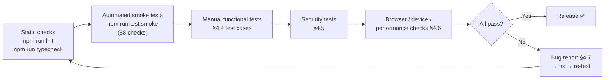

# 4. Testing Guide

*Audience: testers / QA, and developers before every release.*

## 4.1 Test strategy



## 4.2 Test environment

| Item | Value |
|---|---|
| URL (local) | <http://localhost:3000> · admin <http://localhost:3000/admin> |
| Start server | `npm run dev` (or `npm run build && npm start` for production-like testing) |
| Admin login | `ADMIN_EMAIL` / `ADMIN_PASSWORD` from your local `.env` (ask a developer – never share it in tickets or Git) |
| Reset data | `npm run db:reset` ⚠️ deletes everything and restores placeholder content |
| Unlock admin after lockout tests | Wait 15 minutes or restart the server (limits are in memory) |
| Browse the database | `npm run db:studio` |

## 4.3 Automated tests

```bash
npm run dev                 # terminal 1
npm run test:smoke          # terminal 2 – all sections
node scripts/smoke.mjs forms               # only one section: pages | auth | admin | forms
BASE_URL=http://localhost:3200 node scripts/smoke.mjs   # test another server
```

| Section | What it covers |
|---|---|
| `pages` | Every public page returns 200, 404 page, sitemap, robots.txt, OG image, security headers |
| `auth` | Admin pages/APIs blocked without login, sign-in works |
| `admin` | Create / read / update / reorder / delete for each content type, validation errors, XSS stripped, CSV export |
| `forms` | Contact & feedback forms: success, validation, honeypot, cross-site rejection, rate limit |

The script creates its own test data and deletes it afterwards. **Expected result: `88 passed, 0 failed`.**

## 4.4 Manual test cases

Status column: ✅ pass · ❌ fail · ⏭ skipped. Copy this table into your test run sheet.

### Public website

| ID | Area | Steps | Expected result |
|---|---|---|---|
| P-01 | Navigation | Click every menu item (desktop & mobile hamburger) | Each page opens, active item highlighted, mobile menu closes after click |
| P-02 | Home | Open `/` | Hero, services, counters animate, latest articles, testimonials slider, CTA |
| P-03 | About | Open `/about` | Photo, bio, qualifications, timeline, awards, publications, certificates (sections hide when empty) |
| P-04 | Services | Open `/services`, click a service | Detail page with content; hidden services do not appear |
| P-05 | Blog search | `/blog` → search a word in a title | Only matching published articles shown |
| P-06 | Blog filter | Click a category | Only that category's articles; URL updates |
| P-07 | Pagination | With > 6 articles, go to page 2 | Next 6 articles; page 999 shows "no articles" not an error |
| P-08 | Article | Open an article | Title, date, reading time, content, related articles, share image |
| P-09 | Drafts | Open a DRAFT article's URL directly | 404 page |
| P-10 | Gallery | Open an album, click a photo | Lightbox opens; arrows/keyboard/Esc work |
| P-11 | Videos | Play a YouTube, a Vimeo and an uploaded video | All play; category filter works |
| P-12 | Feedback list | Open `/feedback` | Only APPROVED testimonials shown |
| P-13 | Contact – success | Fill all required fields, submit | Success message; inquiry appears in admin as NEW |
| P-14 | Contact – validation | Submit empty / bad email / bad phone | Clear message under each field; nothing saved |
| P-15 | Feedback – submit | Submit feedback with a photo | "Thank you, will appear after review"; appears in admin as PENDING; NOT on site |
| P-16 | Footer | Check footer on every page | Contact details, links, medical disclaimer visible |
| P-17 | Floating buttons | Tap WhatsApp / call on mobile | Opens WhatsApp / dialer with the configured number |
| P-18 | 404 | Open `/does-not-exist` | Friendly 404 page with link home |

### Admin panel

| ID | Area | Steps | Expected result |
|---|---|---|---|
| A-01 | Login | Sign in with correct credentials | Dashboard opens |
| A-02 | Login – wrong | Wrong password | Error message, stays on login |
| A-03 | Protection | Sign out, open `/admin/services` | Redirected to login, then back after signing in |
| A-04 | Settings | Change hero title, save, open home in new tab | New title visible immediately |
| A-05 | Profile | Change name & photo, save | About page and footer show the change |
| A-06 | Services CRUD | Add, edit, hide, reorder (drag), delete a service | Each change reflects on `/services` |
| A-07 | Blog | Create article as DRAFT, then PUBLISH | Draft not public; published appears on `/blog` with today's date |
| A-08 | Rich text | Use headings, lists, links, images, YouTube embed in editor | Formatting shown correctly on the article page |
| A-09 | Slug | Create two articles with the same title | Second gets `-2` slug; both open |
| A-10 | Categories | Delete a category that has articles | Articles remain, now uncategorised |
| A-11 | Gallery | Create album, upload several photos, set cover, delete one photo | Album page updates; deleted photo gone |
| A-12 | Upload limits | Upload a 6 MB image, a `.gif`, a `.exe` renamed to `.jpg` | All rejected with a clear message |
| A-13 | Videos | Add YouTube link, Vimeo link, upload a small MP4 | Thumbnails detected; all play on `/videos` |
| A-14 | Feedback moderation | Approve a PENDING item | Appears on `/feedback` and home slider |
| A-15 | Feedback reject | Reject an approved item | Disappears from the site |
| A-16 | Inquiries | Open NEW inquiry, mark READ then REPLIED; search & filter | Status badges update; filters work |
| A-17 | CSV export | Export inquiries with a filter applied | CSV opens in Excel with only the filtered rows; Hindi text readable |
| A-18 | Home numbers | Edit a counter value | Home page counter shows new value |
| A-19 | Dashboard | Perform some actions | Counts and "Recent activity" update |
| A-20 | Password change | Change password while signed in on 2 browsers | Browser 2 is signed out; new password works, old fails |

## 4.5 Security tests

| ID | Test | How | Expected |
|---|---|---|---|
| S-01 | Login lockout | 6 wrong passwords for one email | "Too many attempts" for 15 min (correct password also blocked) |
| S-02 | Weak password | Change password to `short` | Rejected (min length/complexity) |
| S-03 | XSS in editor | Paste `<script>alert(1)</script>` and `` into article HTML | Saved content has scripts/handlers stripped; no alert on page |
| S-04 | XSS in forms | Submit contact message containing `<script>` | Shown as plain text in admin, never executed |
| S-05 | Malicious links | Set a media URL to `javascript:alert(1)` | Rejected by validation |
| S-06 | Honeypot | Fill hidden `website` field via dev tools, submit | Request silently accepted but nothing saved |
| S-07 | Form rate limit | Submit contact form 6× within 10 min | 6th returns "too many requests" |
| S-08 | CSRF | POST to `/api/admin/services` with `Origin: https://evil.example` and a valid cookie | 403 |
| S-09 | API without login | `curl http://localhost:3000/api/admin/inquiries` | 401 JSON |
| S-10 | File type spoof | Upload a text file renamed `.png` | Rejected (real type checked from bytes) |
| S-11 | Admin not indexed | Check response headers of `/admin/login` | `X-Robots-Tag: noindex` |
| S-12 | Secrets | Search the GitHub repo for passwords / keys | No real values in any committed file |

## 4.6 Browser, device & performance checks

- **Browsers:** latest Chrome, Edge, Firefox, Safari (iOS).
- **Widths:** 360 px (phone), 768 px (tablet), 1280 px+ (desktop) – no horizontal scrolling, readable text, tappable buttons.
- **Lighthouse** (Chrome DevTools → Lighthouse, production build): target ≥ 90 for Performance, Accessibility, Best Practices, SEO.
- **Keyboard only:** Tab through the menu, forms and lightbox; focus is always visible.
- **Social preview:** paste a page URL into WhatsApp / <https://www.opengraph.xyz> (on the deployed site) – title, description and image appear.

## 4.7 Bug report template

```markdown
**Title:** [Area] short description            e.g. [Blog] Search returns drafts
**Test case ID:** P-05
**Environment:** local / staging / production · browser + version · device
**Steps to reproduce:**
1. …
2. …
**Expected:** …
**Actual:** …
**Screenshots / console errors:** …
**Severity:** Critical (site down / data loss / security) · High (feature broken) · Medium (workaround exists) · Low (cosmetic)
```

> Never paste real passwords, `.env` contents or visitors' personal data into a bug report.
